# Measuring Beach Use from a Fixed Webcam: Fused Semantic Segmentation and Person Detection at Kāʻanapali Beach, Maui

**Draft: methodology and results. Working paper.**

---

## Abstract

We present a lightweight computer-vision system that turns a fixed, publicly streaming beach webcam into a long-term record of beach use. A segmentation model labels every pixel in each frame as beach, water, or background, and a person detector locates each visible person; combining the two tells us not only how many people are present but where they are — on the sand, in the water, or elsewhere. Deployed at Kāʻanapali Beach, Maui, from 5 January to 20 October 2026 at 15-minute intervals (9.5 months) and joined to public weather data, the system produced a continuous occupancy record. Over 12,035 daytime frames it recorded 284,325 person detections; after removing 247 repeated frames from a frozen livestream, 11,788 frames contain 277,890 analyzed detections (mean 23.6 people per frame; 58.7% on the beach, 34.9% in the water, 6.4% elsewhere), with a median visible beach area of about 200 m² per person. Water occupancy tracks air temperature closely (r = 0.50). The approach is low-cost, scalable, and reproducible, and shows that a single fixed webcam can supply the kind of long-term occupancy record that coastal managers need to understand crowding and protect sensitive shorelines.

*Keywords:* beach use; occupancy; crowding; webcam remote sensing; semantic segmentation; object detection; SegFormer; YOLO; Hawaiʻi.

---

## 1. Introduction

Human populations are highly concentrated along coasts, with more than 2 billion people living within 100 kilometers of a coast at elevations below 100 m (Reimann et al., 2023). Coastal ecosystems provide critical provisioning, regulating, and cultural services while hosting a disproportionately large share of global biodiversity (Martínez et al., 2007; Nienaber and Imrie-Kuzu, 2025). Anthropogenic development increasingly constrains sandy coasts, with only 33% of sandy shores having less than 100 meters of infrastructure-free space (Lansu et al., 2024). As sea levels rise and shorelines retreat towards coastal developments, beaches have limited space to migrate landward, leading to "coastal squeeze" and the loss of coastal habitat and ecosystem functions (Silva et al., 2020). Sustainable management under the dual threats of intense human development and rapid climate change requires monitoring to understand both coastal dynamics and human presence. Beaches are dynamic socio-ecological systems where physical changes directly influence patterns of human use, behavior, and safety. However, traditional coastal monitoring focuses almost exclusively on physical geomorphology, ignoring how people use beaches (Schlacher et al., 2008). Quantifying beach occupancy provides critical metrics across space and time to inform recreation management, infrastructure planning, public safety, and policy (Epelde et al., 2021; Johnston-González et al., 2024; Sempere-Tortosa et al., 2024). Pairing long-term data on beach occupancy with environmental measurements helps to quantify public exposure to coastal and climate-related hazards, including shoreline erosion, flooding, extreme heat, and degraded water quality (Arnold et al., 2016; Morgan et al., 2000; Pathak et al., 2021; Roig-Munar et al., 2012). However, obtaining continuous, high-resolution beach dynamics and occupancy data over large spatial and temporal scales remains a persistent challenge.

Historically, monitoring beach dynamics and beach visitation relied on manual techniques, including field surveys, ground counts, and periodic aerial or satellite imagery (Provost et al., 2019; De Ruyck et al., 1997). These methods are labor-intensive, prone to human error, and temporally sparse, limiting their ability to capture continuously changing coastal environments and patterns of human activity. Fixed coastal cameras provide a relatively inexpensive and scalable platform for high-frequency and long-term monitoring. Coastal videometry has been widely used to characterize beach dynamics, including wave conditions, shoreline position, and beach morphology (Boak and Turner, 2005; Kim et al., 2020; Lippmann and Holman, 1989), while coastal imagery has also been used to quantify beach user density and patterns of use over months to years (Balouin et al., 2014; Johnston-González et al., 2024; Kammler and Schernewski, 2004). Recent advances in computer vision have expanded capabilities by automating the extraction of information from coastal imagery. Coupled with advancements in edge computing, these systems are no longer restricted to basic video streaming; modern machine learning models enable on-site execution of diverse vision tasks, ranging from real-time rip current identification to human pose estimation (Dumitriu et al., 2023; Maji et al., 2022). For coastal monitoring applications, this multi-task capability allows a single camera to simultaneously monitor physical coastal change and patterns of human use from a single, continuous stream. Employing computer vision models in real-world maritime environments introduces severe technical obstacles. Effective coastal monitoring requires a wide, long-distance field of view, making images inherently subject to extreme target scale variation, perspective distortion, target occlusion, changing illumination, and image quality deterioration from sun glare, rain, fog, haze, and sea spray (Muzammul and Li, 2025; Zou et al., 2023). These conditions make tiny object detection (TOD) challenging. Standard object detection models are benchmarked on general datasets like MS COCO, which classifies objects with an area below 32 by 32 pixels (1,024 square pixels) as "small" (Lin et al., 2014). Models pretrained on these datasets, such as the widely used YOLO variants, often struggle to detect humans from the long-distance perspectives required for meaningful coastal monitoring, where the majority of targets appear at much smaller scales (Jocher et al., 2026; Muzammul and Li, 2025; Nautiyal and Deshmukh, 2026). Addressing this TOD bottleneck has driven key architectural innovations. For example, Lin et al. (2017) demonstrated that Feature Pyramid Networks (FPNs) must utilize lower-level P2 and P3 layers to preserve the high-resolution feature maps essential for detecting small targets while maintaining big-picture context. In the coastal context, researchers have explored scale-matching techniques benchmarked against specialized datasets like TinyPerson (Yu et al., 2019) alongside inference-time image slicing pipelines such as Slicing Aided Hyper Inference (SAHI) (Akyon et al., 2022). However, significant gaps persist, as there are no open-source benchmarks evaluating TOD architectures in ground-based coastal imagery. Furthermore, efforts to spatially contextualize detections rely on rigid composite classes (e.g., "beach person") rather than pairing detection with dynamic shoreline segmentation. Consequently, existing methods struggle to generate the continuous, spatially-precise data required to understand how human behavior responds to environmental drivers like ambient temperature.

The objective of this work is to quantify continuous beach occupancy and crowding at Kāʻanapali Beach, Maui, from a single fixed webcam. Specifically, we (i) detect people in every usable frame with a tiny-object person detector, (ii) segment the same frame into beach, water, and background, and (iii) fuse the two to produce per-frame counts of people on the sand, in the water, and elsewhere, over a 9.5-month record, at 15-minute resolution. Joined with public meteorological data, these counts yield beach area per capita, diurnal and seasonal occupancy curves, and temperature-conditional water use: a continuously sampled occupancy record for this beach. This work makes four contributions. First, a fused segmentation–detection framework unifies person detection and semantic segmentation on a single fixed camera: both models consume byte-identical pixel-masked frames, so every person detection is assigned a spatiotemporally aligned location class (beach, water, or other) by sampling the semantic mask at the box's foot point. Second, a dual-task annotation dataset supports both a tiny-object person detector and a dense waterline segmenter: 1,375 images with 16,599 person boxes and 175 segmentation frames, with a missing-label policy that treats unannotated backgrounds as unknown rather than negative (Xu et al., 2019), and held-out test validation for both tasks. Third, a 9.5-month, ~11,800-frame longitudinal record of beach occupancy at Kāʻanapali Beach (January 5 – October 20, 2026, 15-minute cadence) demonstrates that a lightweight, edge-deployable pipeline can operate continuously across the storm events, rainfall, and seasonal temperature range of the record, including a verification that both models observed exactly the same frames. Fourth, this constitutes a first continuous occupancy record for the site, beach area per capita, diurnal and seasonal occupancy curves, temperature-conditional water use, and water use during brown-water advisories, establishing a baseline for continuous, remote measurement of coastal use.

The approach is deliberately modest, yet the value is in the rigor of the pipeline (shared masking, dense segmentation, and an auditable per-detection record) which makes the derived occupancy metrics transparent and open to be built upon.

## 2. Site and data

### 2.1 Study Area

Kāʻanapali Beach lies on the leeward (west) coast of Maui, Hawaiʻi (~20.92° N, 156.69° W). Roughly 5 km long, it is one of the island's most heavily used resort beaches. Heavy and growing use strains sensitive coastal resources — green sea turtles and Hawaiian monk seals use the nearby waters and shoreline, and a fringing reef fronts the central beach — and seasonal weather shifts when and how the beach can be used: the November–March wet season brings storm surges and swell-driven changes in beach width and water line that reshape the usable sand. The webcam is mounted at The Whaler resort condos on Kāʻanapali Beach near the middle of the beach and looks northwest along the shoreline toward Black Rock, covering roughly 150 m of beachfront. Weather covariates come from the Hawaiʻi Climate Data Portal (HCDP), station 0131 at the Lahaina Wastewater Treatment Plant (WTP; ~4 km inland, 244 m elevation), the nearest Hawaiʻi Mesonet weather station.

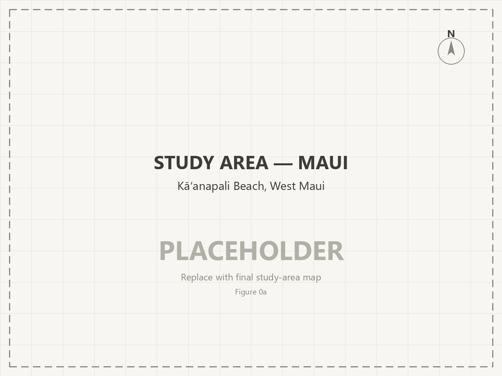

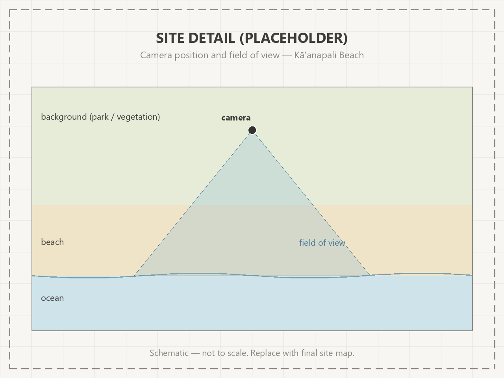

### 2.2 Coastal Camera Imagery

The source is the “Maui Live” webcam operated by WhalerCondo.net, overlooking Kāʻanapali Beach (Lahaina, Maui, Hawaiʻi). Frames are 1912 × 1080 px JPEGs captured at roughly 15-minute intervals and named `youtube_snapshot_Kaanapali_YYYYMMDD_HHMMSS.jpg` with **UTC** timestamps (local time = UTC − 10 h; Hawaiʻi has no DST). The camera view shifted once, at filename cutoff `youtube_snapshot_Kaanapali_20260127_222935` (Jan 27, 2026).

| Property | Value |
|---|---|
| Frames | 21,639 |
| Capture window (UTC) | 2026-01-05 20:56:54 → 2026-10-20 06:49:41 |
| Capture window (HST) | 2026-01-05 10:56 → 2026-10-19 20:49 |
| Night frames excluded | 9,604 (44.4%) |
| Day frames analyzed | **11,788** (55.6% of frames pass the day gate; 247 frozen-stream repeats dropped) |

### 2.3 Image preparation

The 21,639 raw captures pass three preparation steps, which reduce them to the **11,788 analyzed day frames** used throughout the paper. First, night is separated: mean Hue–Saturation–Value (HSV) saturation identifies the 9,604 night frames, because infrared (IR) night frames are literally grayscale (sat ≈ 0) while even dark storm frames keep sat ≥ 26, so a threshold of 5.0 cleanly separates them where a brightness threshold would fail. Second, the analyzable scene is bounded by two region-of-interest (ROI) polygons (one pre-move, one post-move), and a small exclusion triangle masks a persistently misclassified palm-canopy patch in post-move frames. Third, the archiver occasionally saved the same image under successive timestamps when the livestream froze; these frozen repeats are detected as runs of two or more consecutive frames whose segmentation pixel counts *and* people counts are all identical, a signature that does not occur by chance. Every frame in such a run is flagged `frozen_dup` (the first included, since the freeze may have begun before it), and all 247 such frames across 14 freeze events (longest 37 consecutive frames) are dropped before analysis. This also resolves what initially looked like a timestamp anomaly: the “bright frame at a computed night hour” cases (flagged `ts_suspect`) all fall inside frozen runs: a stuck daytime image kept accumulating new timestamps.

### 2.4 Model Training and Evaluation Data

The two models are trained and evaluated on two labelled sets. The segmentation label set contains 175 frames (121 train, 35 validation, 19 test), all captured during a single week, November 15–23, 2025, across four classes: `background`, `base-background-layer-segmentation` (palm canopy), `beach`, and `water`. During preprocessing, pixels outside the ROI polygon are forced to background. The detection label set contains 1,375 images (969 train, 272 validation, 134 test) carrying 16,599 person bounding boxes, about twelve per image. The webcam portion spans September 2, 2025 through March 23, 2026; the remaining images come from the TinyPerson dataset (Yu et al., 2019) to add scene diversity.

### 2.5 External data

| Source | Content | Coverage | Resolution |
|---|---|---|---|
| HCDP station 0131 (Lahaina WTP; 20.8907, −156.6549) | air temp (2 sensors), relative humidity (RH; 2 sensors), wind speed, 5-min rainfall, incoming shortwave & net radiation | 2025-12-31 → 2026-10-21 | 5 min |
| Hawaiʻi Department of Health (DOH), Clean Water Branch | Brown Water / beach advisories (issuance–cancellation) | full archive; 2026 used here | events |

The HCDP pull covers the full frame window. Solar exposure uses the station's `SWin_1_Avg` pyranometer (incoming shortwave radiation, W/m²), with `Rnet_1_Avg` (net radiation) as a secondary measure; its PAR channels are not populated.

## 3. Methods

### 3.1 Semantic segmentation (where is beach vs. water?)

The segmentation model is a pre-trained neural network (SegFormer-B2, Xie et al., 2021) that we fine-tuned to assign every pixel in each frame to one of four land-cover classes: beach, water, background, or the overhanging palm canopy. Because it labels every pixel at once, it produces a complete land-cover map of the whole beach with no uncovered gaps — a key advantage over any method that only reports where people are. After fine-tuning, its predictions agreed with the hand-labelled ground truth to near-perfect accuracy (mean Intersection-over-Union ≈ 0.992). The exact training settings (learning rate, optimizer, and number of training rounds) are recorded in the repository and Appendix A.

We used this pixel-labeling approach rather than the earlier person-detector-based method because it covers every pixel and therefore has no gaps, whereas the detector-based method left small uncovered regions that had to be filled in by an error-prone fallback. On the 19-image test set — comparing each full-frame prediction against the hand-labelled ground truth, with uncovered pixels counted as errors — the segmentation approach was clearly the better choice:
| Model | ROI uncovered | Mean pixel IoU |
|---|---|---|
| YOLO26m-seg @960 | 0.6% | 0.908 |
| YOLO26l-seg @960 | 14.3% | 0.820 |
| **SegFormer-B2 @512** | **0%** (dense output) | **≈0.992 mIoU (val)** |

For each new frame the pipeline first applies the same night gate and the same analysis-region mask used everywhere else (the mask also excludes a small, persistently misclassified palm-canopy patch), then runs the segmentation model and reads out, for every pixel inside the analysis region, which land-cover class it belongs to. This yields a per-frame count of beach, water, and background pixels and the land-cover map later used to place each detected person.


### 3.2 Person detection (who is in the scene?)

Person detections come from an object detector that draws a bounding box around each visible person. Because the camera sits high and people — especially those far down the beach — appear very small, each image is split into three overlapping strips along the beach, where people are visible, and the detector is run on each strip separately; detections from the overlapping strips are then combined so each person is counted once. The detector is a YOLO26 'large' model with an extra high-resolution detection layer added specifically to catch very small objects (median person box ≈ 13 px, with 47% under 12 px; Figure 2). The same night gate and analysis-region mask are applied as for the segmentation.


We trained the detector on the 1,375 labelled images and stopped automatically once its performance stopped improving; the full training recipe (batch size, number of rounds, learning rate, and the image-augmentation settings) is recorded in the repository and Appendix A. What matters for interpretation is its accuracy on images it had never seen: on the held-out test set (134 images containing 1,695 people), it found about 66% of the people present (recall) and about 71% of its boxes were correct (precision) — roughly one person in three was missed and one box in four was spurious.

In the production run the detector is applied to the three strips at a detection-confidence threshold of 0.20, and any duplicate boxes from overlapping strips are merged so each person is counted once. It is fed exactly the same masked images as the segmentation model, so the two outputs are based on identical input. Every detection is saved with its image name, confidence, and bounding-box coordinates.


### 3.3 Fusion: where is each person?

Each box is assigned a zone by the segmentation class at its **foot point**, the bottom-center pixel of the box, i.e. where the person physically stands:
| Land cover at the person's feet | Zone counted |
|---|---|
| Beach (class 2) | On the beach |
| Water (class 3) | In the water |
| Background / palm canopy (class 0 / 1) | Other (boardwalk, pool deck, or outside the analysis region) |

The fused output carries one row per analyzed (non-night) frame: counts per zone, totals, and parsed UTC/local timestamps.

### 3.4 Derived metrics

Three derived metrics support the analysis. Beach area per capita is the beach-class pixel area divided by the number of beach-zone people; it is reported primarily in image units (px² per person), which is exact, while absolute square meters use an anchored effective scale of 0.0138 m²/px derived from three hand-measured map polygons matched to quantiles of segmented beach pixel area (§4.4 and Limitations). Occupancy curves are the per-frame, hourly, and daily aggregates of the beach, water, and other counts. The weather response joins each frame to the nearest 5-minute HCDP observation within ±10 minutes and bins occupancy against temperature, solar radiation, humidity, wind, and rain.

## 4. Results

### 4.1 Pipeline output at scale

| Quantity | Value |
|---|---|
| Day frames analyzed | 11,788 (247 frozen-stream frames dropped) |
| Person detections (conf ≥ 0.20) | 277,890 analyzed (284,325 boxes in the raw detection table) |
| Mean / median / max people per frame | 23.6 / 20 / 118 |
| Frames with zero detections | 505 (4.3%) |
| Zone split: beach / water / other | 58.7% / 34.9% / 6.4% |
| Segmented beach area (mean % of ROI) | 30.7% (median 30.2; range 6.4–51.1) |
| Segmented water area (mean % of ROI) | 69.0% (median 69.4; range 48.5–93.2) |
| Inference throughput (GPU) | ~10.2 frames/s (detection incl. tiling + non-maximum suppression) |

Low beach-area outliers correspond to storm-surge days (mid-March and early October events), where visible sand shrinks toward ~6%.


### 4.2 Temporal usage patterns

Averaging occupancy by local hour shows a midday peak: total people peak near 13:00 (≈40 per frame), beach occupancy peaks around noon, and water occupancy peaks later, around 14:00, consistent with visitors moving from sand to sea as the afternoon warms. Seasonally, daily mean occupancy is highest in February 2026 (busiest day February 11, ≈54 people per frame) and collapses during storm events (quietest day March 13, ≈1.4 people per frame; the mid-March storm that also drives the lowest beach-area values). High summer months show moderate, steadier occupancy. The full per-day series is reproduced in the companion notebook in the repository.

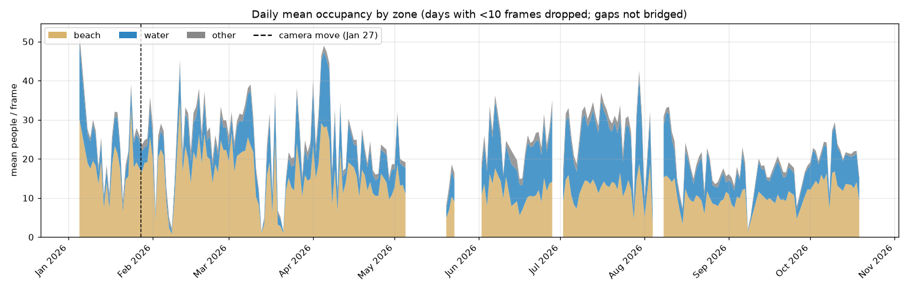

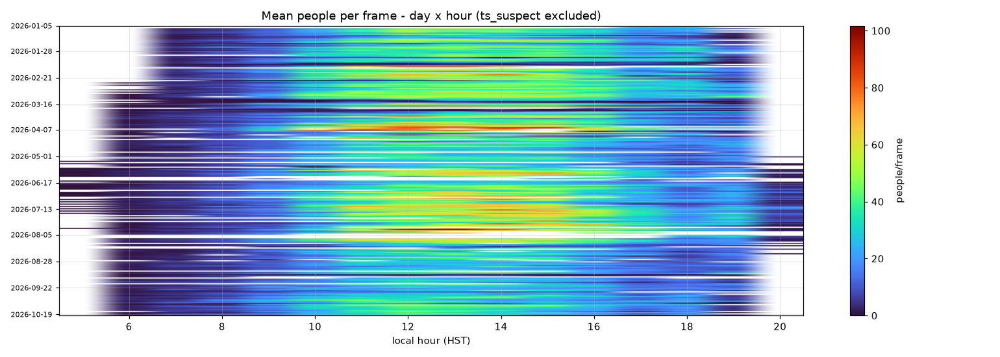

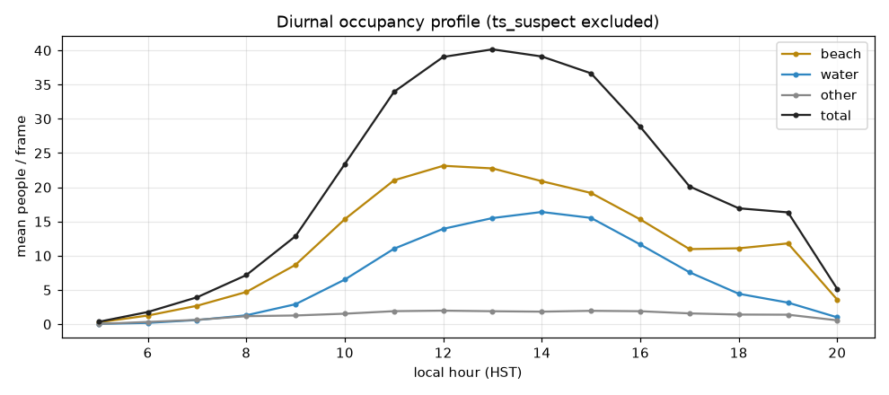

### 4.3 Temperature-conditioned usage

All 11,788 day frames join to 5-min HCDP observations (±10 min nearest). Air temperature at Lahaina WTP ranged 16.6–32.2 °C. Correlations with per-frame counts (n = 11,788):
| Covariate | beach | water | total |
|---|---|---|---|
| incoming solar radiation (SWin_1_Avg) | +0.50 | +0.53 | **+0.59** |
| net radiation (Rnet_1_Avg) | +0.49 | +0.52 | +0.58 |
| air temperature (Tair_avg) | +0.26 | **+0.50** | +0.42 |
| relative humidity (RH_avg) | −0.35 | −0.37 | **−0.42** |
| wind speed (WS_1_Avg) | −0.07 | −0.03 | −0.06 |

Rainfall has the strongest suppressive effect of any covariate. 280 day frames (2.4%) coincide with measurable rain (>0.05 mm per 5 min). Their mean occupancy is **4.8 people vs 24.0 on dry frames, an 80% reduction** (beach −84%, water −76%). The suppression is asymmetric across zones: beach counts collapse to ~1/6 of their dry mean (14.1 → 2.3 people/frame) while water counts fall only to ~1/4 (8.4 → 2.0), so the water:beach ratio rises from 0.59 on dry frames to 0.89 in the rain: the die-hards who show up during rain preferentially go into the water rather than sit on the sand. Within rainy frames, heavier rain suppresses further only weakly (r(rain intensity, total) ≈ −0.17): any detectable rain already empties the beach. The temperature association persists in rain (r = +0.38 within rainy frames), while humidity and wind are negative (RH −0.40, wind −0.25). Binned means show water use rising monotonically from ≈1 person at 18–19 °C to ≈17 at 29–32 °C, while beach occupancy saturates in the mid-20s and declines slightly at the hottest bins:

| Tair (°C) | beach | water | total |
|---|---|---|---|
| 17–18 | 2.3 | 0.6 | 3.4 |
| 21–22 | 6.2 | 1.5 | 8.9 |
| 24–25 | 17.6 | 6.8 | 25.9 |
| 27–28 | 15.1 | 13.5 | 30.4 |
| 29–30 | 15.3 | 16.8 | 33.9 |
| 31–32 | 17.3 | 17.3 | 36.1 |

Interpretation: at this site, *temperature primarily drives water occupancy*; beach occupancy saturates in the mid-20s °C while water usage keeps rising to ≈30 °C. RH is negatively associated (−0.4), consistent with rain and high-humidity days suppressing beach use.
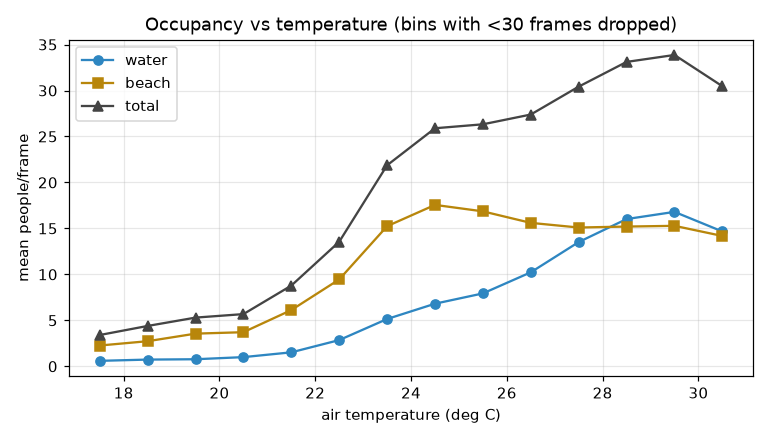

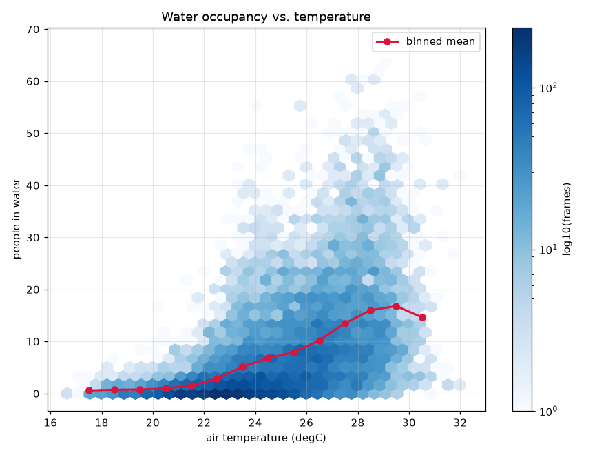

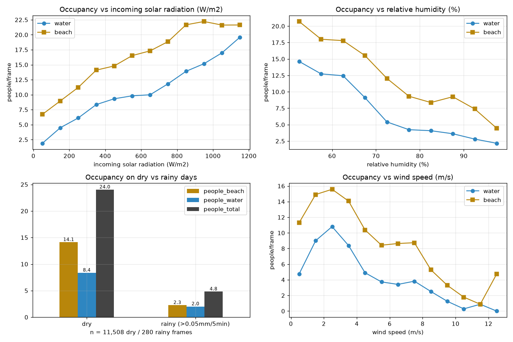

### 4.4 Beach area per capita

Mean visible beach area is ≈193 k px (≈30.7% of the ~647 k-px ROI). Converting to real area is approximated with an **anchored effective scale**:

three hand-measured Google Maps polygons of the visible sand at high / mid / low waterlines (1,779 / 2,820 / 3,387 m²) were matched to the p10 / p50 / p90 quantiles of the segmented beach pixel area, giving per-anchor scales 0.0142 / 0.0148 / 0.0129 m²/px; pooled **k = 0.0138 m²/px** (±~7% spread across anchors, which also absorbs perspective foreshortening on average). This yields mean visible beach ≈**2,670 m²** and a crowding distribution of **median ≈200 m²/person**, p10 ≈85 on crowded frames, p90 ≈1,000 on empty ones. The image-space metric (px²/person) remains calibration-free.

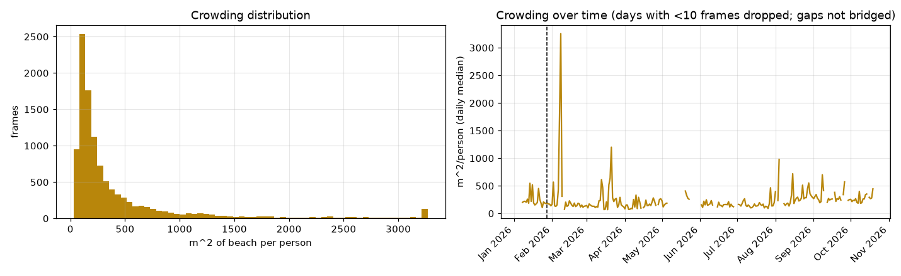

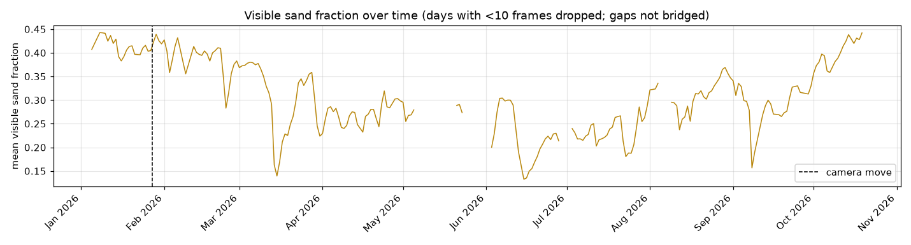

### 4.5 Occupancy during Brown Water Advisories

Hawaii DOH Clean Water Branch issues Brown Water Advisories (BWA) when storm runoff renders coastal water unsafe. In 2026, two **island-wide** Maui advisories covered Kāʻanapali: Mar 16–Apr 2 and Aug 15–24 (28 advisory days); the year's other named stretches (Hanakaoʻo, Wahikuli, Lahaina, Kihei, north shore) lie outside the camera view.

Water occupancy is compared at the **day** level (15-min frames are heavily autocorrelated) against non-advisory days in the **same calendar month**, as a ratio with a day-level bootstrap 95% confidence interval (CI; days contributing <10 frames are dropped). Result: **no detectable deterrence**: mean water occupancy on BWA days was 7.0 people/frame vs 7.5 on same-month baseline days (30 vs 56 days), ratio **0.94 [0.74–1.18]**. Formal tests agree: Mann–Whitney U on day-level means gives p = 0.97, and a 20,000-draw permutation test on the ratio gives p = 0.64, far from significance at α = 0.05.

In plain terms, each p-value answers the question: *if advisory days were actually no different from ordinary days in the same months, how often would random chance produce a gap at least this big?* The Mann–Whitney test answers it for the rank ordering of the day-level means (p = 0.97, a split this even or more extreme happens essentially always by chance); the permutation test answers it by reshuffling the "advisory" label across all 86 days 20,000 times and recounting the ratio each time (the observed 0.94 is exceeded in extremity 64% of the time). Both sit far above the conventional 0.05 cutoff, so the data contain no detectable deterrence signal, though with only 30 advisory days the tests also cannot rule out a small effect. Per advisory:

Mar–Apr 0.88, Aug 1.05. Visitors kept entering the water during posted brown-water advisories at statistically unchanged rates. This is descriptive, not causal: BWAs are issued *because* of the runoff-generating weather that independently suppresses beach use, so the baseline days themselves differ in weather mix; if anything the comparison is conservative for deterrence. Awareness/behavioral effects cannot be separated from weather without survey data.

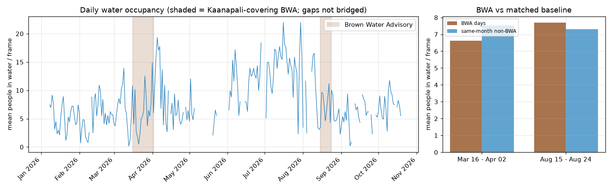

## 5. Discussion

The system works because the hard problems were simplified honestly. Night filtering exploits the IR camera's exact zero-saturation signature rather than brightness thresholds that discard storm frames. Segmentation is dense by construction, eliminating the coverage-hole failure mode that made the earlier YOLO instance pipeline untrustworthy for area statistics. Both models consume identical masked inputs, so the fusion step's only assumption is the foot-point heuristic.

Detection accuracy is the binding constraint. At conf 0.20 the merged test evaluation gives precision 0.71 / recall 0.66: counts are useful for relative analytics and time series but carry multiplicative error: roughly one in three people missed and one in four boxes spurious. For trend analysis this is acceptable; for absolute occupancy claims it argues for a recall-oriented confidence sweep or additional labeled frames.

With no fieldwork at all, the pipeline produces a crowding proxy in real time, a beach-versus-water allocation that most counts collapse into a single headcount, and weather-conditioned usage: here, a clear, monotone temperature response concentrated in the water. These are exactly the quantities a continuous occupancy study needs, at a density (~46 usable frames per day) that survey teams cannot match. We deliberately do not estimate beach carrying capacity as the management literature defines it, an acceptable level of use judged by visitor experience, which requires survey input (De Ruyck et al., 1997; Schlacher et al., 2008); we provide the objective occupancy side of that assessment: the continuous counts and densities against which acceptability could later be evaluated.

## 6. Limitations

1. **Uncalibrated geometry.** The m² scale is a frame-averaged effective
value anchored to three hand-measured map polygons (±~7% anchor spread); perspective foreshortening means the error varies by position, and absolute accuracy is plausibly ±30%. A four-point homography from surveyed ground control would give true per-pixel areas.
2. **Foot-point zoning** misclassifies people wading at the swash boundary
(feet in water, body on sand) and boardwalk pedestrians whose feet are cropped. Class-1 canopy pixels are folded into supervised classes by the ignore-index training setting.
3. **Conf threshold 0.20** maximizes count sensitivity at some precision cost;
no per-zone confidence sweep has been done yet.
4. **Labels are narrow in time.** Segmentation labels cover only Nov 15–23,
2025, yet the model holds up across the full 9.5-month deployment, which is itself evidence of robustness; detection webcam labels run Sep 2025–Mar
   2026. Any future annotation round should evaluate on held-out **days**,
not frames (adjacent frames leak).
5. **Autocorrelation.** 15-min frames are far from independent; correlations
reported are descriptive, not significance-tested.
6. **Weather station placement.** Lahaina WTP (station 0131, 244 m elevation)
is ~4 km inland and likely runs warmer/drier than the beach.
7. **Frozen-stream frames.** 247 frames in 14 freeze events carry repeated
images under successive timestamps; flagged `frozen_dup` and dropped entirely. Their detections (6,435 boxes, 2.3% of the raw record) are excluded from all analysis.
8. **Single camera, single beach.** Detection count ≠ people density per
shoreline meter; occlusion and perspective compression bias counts at the far (Black Rock) end.

## 7. Conclusion and future work

Two commodity models over one fixed webcam already deliver the core measurements of continuous beach-use monitoring: who is on the sand, who is in the water, how much beach there is, and how all three respond to time and temperature. The immediate next steps are (i) homography calibration for true m², (ii) a confidence-sweep/bias correction on person counts, (iii) a second annotation round on hard/seasonal frames, and (iv) significance-aware time series models (e.g., block bootstrap over days) before publishing usage elasticities. A Streamlit dashboard built on these products already exists for deployment.

## References

Akyon, F. C., Altinuc, S. O., & Temizel, A. (2022). Slicing Aided Hyper Inference and fine-tuning for small object detection. 2022 IEEE International Conference on Image Processing (ICIP) (pp. 966–970). IEEE. https://doi.org/10.1109/ICIP46576.2022.9897990 Arnold, B. F., Wade, T. J., Benjamin-Chung, J., Schiff, K. C., Griffith, J. F., Dufour, A. P., Weisberg, S. B., & Colford, J. M. (2016). Acute Gastroenteritis and Recreational Water: Highest Burden Among Young US Children. American Journal of Public Health, 106(9), 1690–1697. https://doi.org/10.2105/AJPH.2016.303279 Balouin, Y., Rey-Valette, H., & Picand, P.-A. (2014). Automatic assessment and analysis of beach attendance using video images at the Lido of Sète beach, France. Ocean & Coastal Management, 102, 114–122. https://doi.org/10.1016/j.ocecoaman.2014.09.006 Boak, E., & Turner, I. (2005). Shoreline Definition and Detection: A Review. Journal of Coastal Research, 21(4), 688–703. https://doi.org/10.2112/03-0071.1 Dumitriu, A., Tatui, F., Miron, F., Ionescu, R. T., & Timofte, R. (2023). Rip Current Segmentation: A Novel Benchmark and YOLOv8 Baseline Results. 2023 IEEE/CVF Conference on Computer Vision and Pattern Recognition Workshops (CVPRW) (pp. 1261–1271). IEEE. https://doi.org/10.1109/CVPRW59228.2023.00133 De Ruyck, M. C., Soares, A. G., & McLachlan, A. (1997). Social Carrying Capacity as a Management Tool for Sandy Beaches. Journal of Coastal Research, 13(3), 822–830.

Epelde, I., Liria, P., Santiago, I., Garnier, R., Uriarte, A., Picón, A., Galdrán, A., Arteche, J. A., Lago, A., Corera, Z., Puga, I., Andueza, J. L., & Lopez, G. (2021). Beach carrying capacity management under Covid-19 era on the Basque Coast by means of automated coastal videometry. Ocean & Coastal Management, 208, 105588. https://doi.org/10.1016/j.ocecoaman.2021.105588 Jocher, G., Qiu, J., Liu, M., Lyu, S., Akyon, F. C., & Kalfaoglu, M. E. (2026). Ultralytics YOLO26: Unified Real-Time End-to-End Vision Models. arXiv:2606.03748 [cs.CV]. https://doi.org/10.48550/arXiv.2606.03748 Johnston-González, R., Adarraga, E., Coca, O., Correa, M., de la Hoz, E., Legarda, G., Navarro, J., Ramírez, M., Rozo, A., & Ricaurte-Villota, C. (2024). Artificial intelligence for beach monitoring: An experimental study of beach attendance at El Rodadero, Colombia. Ocean & Coastal Management, 253. https://doi.org/10.1016/j.ocecoaman.2024.107159 Kammler, M., & Schernewski, G. (2004). Spatial and temporal analysis of beach tourism using webcam and aerial photographs. In G. Schernewski & N. Löser (Eds.), Managing the Baltic Sea: BaltCoast 2004 – Conference Proceedings (Coastline Reports, Vol. 2, pp. 121–128). EUCC – The Coastal Union.

Kim, J., Kim, J., Kim, T., Huh, D., & Caires, S. (2020). Wave-Tracking in the Surf Zone Using Coastal Video Imagery with Deep Neural Networks. Atmosphere, 11(3), 304. https://doi.org/10.3390/atmos11030304 Lansu, E. M., Reijers, V. C., Höfer, S., Luijendijk, A., Rietkerk, M., Wassen, M. J., Lammerts, E. J., & van der Heide, T. (2024). A global analysis of how human infrastructure squeezes sandy coasts. Nature Communications, 15, 432. https://doi.org/10.1038/s41467-023-44659-0 Lin, T.-Y., Maire, M., Belongie, S., Bourdev, L., Girshick, R., Hays, J., Perona, P., Ramanan, D., Dollár, P., & Zitnick, C. L. (2014). Microsoft COCO: Common objects in context. arXiv:1405.0312 [cs.CV]. https://doi.org/10.48550/arXiv.1405.0312 Lin, T.-Y., Dollár, P., Girshick, R., He, K., Hariharan, B., & Belongie, S. (2017). Feature Pyramid Networks for Object Detection. arXiv:1612.03144 [cs.CV]. https://doi.org/10.48550/arXiv.1612.03144 Lippmann, T., & Holman, R. (1989). Quantification of Sand Bar Morphology: A Video Technique Based on Wave Dissipation. Journal of Geophysical Research: Oceans, 94. https://doi.org/10.1029/JC094iC01p00995 Maji, D., Nagori, S., Mathew, M., & Poddar, D. (2022). YOLO-Pose: Enhancing YOLO for multi person pose estimation using object keypoint similarity loss. arXiv:2207.11883 [cs.CV]. https://doi.org/10.48550/arXiv.2207.11883 Martínez, M. L., Intralawan, A., Vázquez, G., Pérez-Maqueo, O., Sutton, P., & Landgrave, R. (2007). The coasts of our world: Ecological, economic and social importance. Ecological Economics, 63(2), 254–272. https://doi.org/10.1016/j.ecolecon.2005.11.008 Morgan, R., Gatell, E., Junyent, R., Micallef, A., Özhan, E., & Williams, A. (2000). An improved user-based beach climate index. Journal of Coastal Conservation, 6, 41–50. https://doi.org/10.1007/BF02730466 Muzammul, M., & Li, X. (2025). Comprehensive review of deep learning-based tiny object detection: Challenges, strategies, and future directions. Knowledge and Information Systems. https://doi.org/10.1007/s10115-025-02375-9 Nautiyal, R., & Deshmukh, M. (2026). Tiny object detection: An in-depth survey of techniques, challenges, and future directions. Digital Signal Processing. https://doi.org/10.1016/j.dsp.2026.105995 Nienaber, A.-M., & Imrie-Kuzu, D. (2025). Transformative Change in Coastal Biodiversity Conservation: A Systematic Literature Review of Governance, Social–Ecological, and Cultural Pathways. Sustainability, 17(24), 11186. https://doi.org/10.3390/su172411186 Pathak, A., van Beynen, P. E., Akiwumi, F. A., & Lindeman, K. C. (2021). Impacts of climate change on the tourism sector of a Small Island Developing State: A case study for the Bahamas. Environmental Development, 37, 100556. https://doi.org/10.1016/j.envdev.2020.100556 Provost, E. J., Butcher, P. A., Colefax, A. P., Coleman, M. A., Curley, B. G., & Kelaher, B. P. (2019). Using drones to quantify beach users across a range of environmental conditions. Journal of Coastal Conservation, 23(3), 633–642. https://doi.org/10.1007/s11852-019-00694-y Reimann, L., Vafeidis, A. T., & Honsel, L. E. (2023). Population development as a driver of coastal risk: Current trends and future pathways. Cambridge Prisms: Coastal Futures, 1, e14. https://doi.org/10.1017/cft.2023.3 Roig-Munar, F. X., Martín-Prieto, J. A., Rodríguez-Perea, A., Pons, G. X., Gelabert, B., & Mir-Gual, M. (2012). Risk Assessment of Beach–Dune System Erosion: Beach Management Impacts on the Balearic Islands. Journal of Coastal Research, 28(5), 1488–1499. https://doi.org/10.2112/jcoastres-d-11-00187.1 Schlacher, T. A., Schoeman, D. S., Dugan, J. M., Lastra, M. J., Jones, A. P., Scapini, F. L., & McLachlan, A. (2008). Sandy beach ecosystems: Key features, sampling issues, management challenges and climate change impacts. Marine Ecology, 29(Suppl. 1), 70–90. https://doi.org/10.1111/j.1439-0485.2007.00204.x Silva, R., Martínez, M. L., Tussenbroek, B. I., Guzmán-Rodríguez, L. O., Mendoza, E., & López-Portillo, J. (2020). A framework to manage coastal squeeze. Sustainability, 12(24), 10610. https://doi.org/10.3390/su122410610 Sempere-Tortosa, M., Toledo, I., Marcos-Jorquera, D., Carbonell, D., Gilart-Iglesias, V., & Aragonés, L. (2024). A new occupancy index model based on artificial vision for enhancing beach management. Journal of Environmental Management, 370, 122675. https://doi.org/10.1016/j.jenvman.2024.122675 Xie, E., Wang, W., Yu, Z., Anandkumar, A., Alvarez, J. M., & Luo, P. (2021). SegFormer: Simple and Efficient Design for Semantic Segmentation with Transformers. arXiv:2105.15203 [cs.CV]. https://doi.org/10.48550/arXiv.2105.15203 Xu, M., Bai, Y., & Ghanem, B. (2019). Missing Labels in Object Detection. In Proceedings of the IEEE/CVF Conference on Computer Vision and Pattern Recognition (CVPR) Workshops. https://openaccess.thecvf.com/content_CVPRW_2019/html/Weakly_Supervised_Learning_for_RealWorld_Computer_Vision_Applications/Xu_Missing_Labels_in_Object_Detection_CVPRW_2019_paper.html Yu, X., Gong, Y., Jiang, N., Ye, Q., & Han, Z. (2019). Scale Match for Tiny Person Detection. arXiv:1912.10664 [cs.CV]. https://doi.org/10.48550/arXiv.1912.10664 Zou, Z., Chen, K., Shi, Z., Guo, Y., & Ye, J. P. (2023). Object Detection in 20 Years: A Survey. Proceedings of the IEEE, 111(3), 257–276. https://doi.org/10.1109/JPROC.2023.3238524

## Appendix A: Reproduction

All commands below run from the repository root (https://github.com/jswlee/ai-beach-carrying-capacity).

```bash

# Segmentation: labels → train → infer → waterline
python preprocess_masks.py && python train_fast.py
python test_viz_segformer.py --model trained_models/segformer-waterline-v11i/best_model \
    --dataset-dir "D:/Kaanapali" --save-masks --workers 4 --output-dir Kaanapali_full_segformer_v2
python extract_waterline.py

# Detection: preprocess → train (yolo26l-p2) → fused-mask inference
python training/preprocess_and_train.py --enable-slicing --person-only --p2 --model yolo26l.pt
python training/run_tiled_inference.py --model <best.pt> --input-dir "D:/Kaanapali" \
    --seg-mask --save-img --max-save-img 10 --save-day-only --device cuda --conf 0.20 \
    --output-dir kaanapali_segmask_inference

# Fusion → people_zones.csv; analytics → analysis/beach_capacity_analysis.ipynb
python segmentation/count_people_zones.py --detections <det_out>/detections.csv \
    --masks-dir Kaanapali_full_segformer_v2/masks --output Kaanapali_full_segformer_v2/people_zones.csv
```

## Appendix B: Artifact manifest

Paths are relative to the repository root unless noted.
| Artifact | Location | Description |
|---|---|---|
| Seg weights | `trained_models/segformer-waterline-v11i/best_model` (HF format) | produced by `train_fast.py`; ONNX export alongside |
| Det weights | YOLO26l-P2 `best.pt`, run `yolo26l_p2_beach_detection_20260524_162410` | md5 c2246c8e…fc90 |
| Seg outputs | `data/mask_stats_clean.csv`, `data/waterline_stats.csv`, `data/night.txt`, `data/people_zones.csv` | per-frame class stats, waterline, night list, zone counts |
| Det outputs | `data/detections.csv`, `data/night_detections.txt` | 284,325 boxes; night list byte-identical to seg |
| Weather / external | `data/external/` | HCDP 5-min obs, NOAA tide, DOH advisories, BWA periods |
| Det run records | `detection/results/` | args.yaml, training_summary.txt, results.csv, merged_metrics.json, annotation_analysis/ |
| Seg methodology | `segmentation/waterline_methodology.md` | operational detail beyond this paper |
| Analysis | `analysis/beach_capacity_analysis.ipynb` | reproduces every figure and statistic in this paper |
